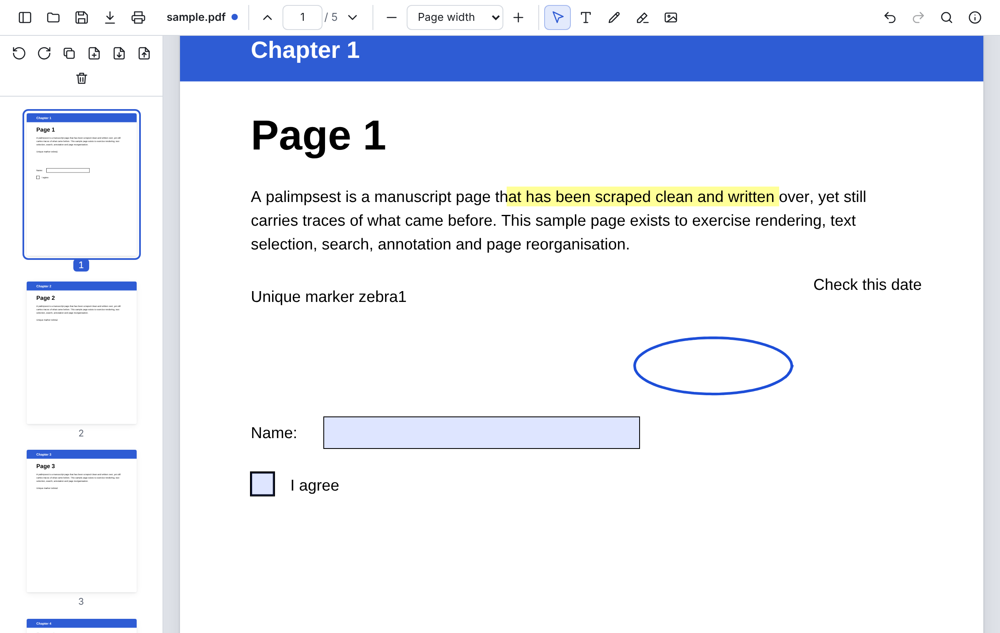

# Palimpsest

An open source PDF viewer and editor that runs as an installable Chromium app. Everything happens on your device; files are never uploaded.



## Features

- **View**: fast rendering, text selection, search (match case / whole words), links, zoom presets and Ctrl+wheel zoom, page thumbnails.
- **Annotate**: add text, draw, highlight (select text, or draw freely), place images and signature scans. Annotations are saved as standard PDF annotations, so other viewers show them and Palimpsest can edit them again later.
- **Fill forms**: AcroForm fields render as editable inputs and their values are saved into the file.
- **Organise pages**: rotate, delete, duplicate, reorder by dragging, insert blank pages, insert pages from other PDFs (drop them on the page list), save a selection as a new PDF.
- **Document properties**: edit title, author, subject and keywords.
- **Undo/redo** across both annotation edits and page operations.
- **Save in place**: a file opened from disk (or from the OS "Open with" menu once installed) is written back to the same file. Save as and print are also included.
- **Works offline** once the app has been used, with light and dark themes.

## Run it

Requires Node.js 22.13 or later and a Chromium-based browser (Chrome, Chromium, Edge, Brave).

```bash
npm install
```

**As a desktop app window:**

```bash
npm run app
```

```bash
npm run app -- path/to/file.pdf
```

This builds the app if needed, serves it on `127.0.0.1:4317`, and opens it in a Chromium `--app` window with its own profile. Set `CHROME_PATH` if your browser isn't found.

**Installed as a PWA** (the recommended way): run `npm run build && npm run preview`, open http://localhost:4173 in Chrome or Edge, and choose **Install** in the address bar. You get a standalone window, a launcher icon, and Palimpsest appears under "Open with" for PDF files. Any static host works for `dist/`. Installing needs HTTPS, except on localhost.

**For development:**

```bash
npm run dev
```

## Keyboard shortcuts

| Action | Keys |
| --- | --- |
| Open / Save / Save as / Print | Ctrl+O / Ctrl+S / Ctrl+Shift+S / Ctrl+P |
| Find | Ctrl+F, then Enter / Shift+Enter |
| Zoom in / out / reset | Ctrl+= / Ctrl+− / Ctrl+0 (or Ctrl+wheel) |
| Undo / Redo | Ctrl+Z / Ctrl+Shift+Z or Ctrl+Y |
| Tools: select, text, draw, highlight, image | V, T, D, H, I (Esc returns to select) |
| Page list: move, extend selection, select all | Arrows, Shift+Arrows, Ctrl+A |
| Page list: delete / duplicate selected | Delete / Ctrl+D |
| Toggle page list | F4 |

## How it works

| Concern | Implementation |
| --- | --- |
| Rendering, text layer, search, links, forms | [pdf.js](https://github.com/mozilla/pdf.js) viewer component (`pdfjs-dist/web/pdf_viewer.mjs`) |
| Annotation editing and saving | pdf.js annotation editor; `saveDocument()` appends edits as an incremental update |
| Reorder, delete, duplicate, insert, extract | pdf.js page assembler (`PDFDocumentProxy.extractPages`), which writes a new file containing only reachable objects, so deleted pages are really gone. It keeps forms, outlines, named destinations, page labels and the structure tree. |
| Rotation, metadata, blank pages | [pdf-lib](https://github.com/Hopding/pdf-lib) |
| File access | File System Access API with `<input type=file>` and download fallbacks; `launchQueue` for OS file handling |
| Offline | A small service worker (`public/sw.js`) |

A page operation first folds pending annotations into the current bytes, transforms them, and reloads the result. Each step keeps a snapshot for undo. Annotation edits between page operations use pdf.js's own undo stack.

```
src/
  app.ts          UI controller: viewer wiring, tools, page ops, save, undo
  pageops.ts      page plans → pdf.js extractPages(); pdf-lib edits
  thumbnails.ts   page list: lazy thumbnails, selection, drag and drop
  files.ts        open/save via File System Access API with fallbacks
  history.ts      document-level undo/redo snapshots
  print.ts        rasterised printing
  pdfjs.ts        pdf.js setup (worker, fonts, CMaps, WASM)
scripts/
  launch.mjs      `npm run app`: local server + Chromium app window
tests/
  unit/           Vitest: page plans and assembly, run against pdf.js in Node
  e2e/            Playwright: the real app in Chromium; saved files are decoded and checked
```

## Testing

```bash
npm run typecheck
npm test
npm run test:e2e
```

The end-to-end tests stub the native file pickers, drive the UI, and parse each saved PDF with pdf.js to check pages, rotation, annotations, form values and metadata. CI runs all three on every push (`.github/workflows/ci.yml`).

## Known limitations

- Text that is already in the PDF can't be edited in place. You can annotate over it, or cover it with an image.
- Reorganising pages (delete, move, insert, duplicate) rebuilds the file without optional-content layers, the document-level XMP metadata, and document JavaScript.
- Rotation and property edits use pdf-lib, which can't write encrypted PDFs. These actions show an error on encrypted files. Opening (with the password), annotating, form filling and page reorganisation still work, and the saved file stays encrypted.
- Signatures are visual (drawn or image) only. There is no cryptographic signing, and changing a digitally signed PDF flags or invalidates its signatures.
- The annotation tools are unavailable on pure XFA forms.
- `pdfjs-dist` is pinned to an exact version because the app uses its viewer and page-assembly APIs.

## License

MIT, see [LICENSE](LICENSE). Bundles pdf.js (Apache-2.0) and pdf-lib (MIT).
