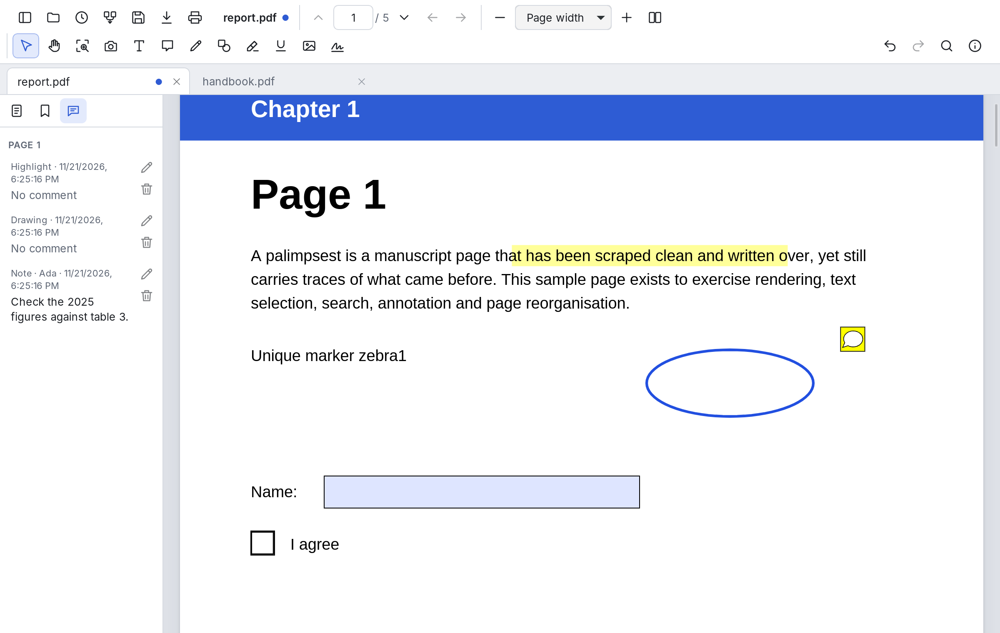

# Palimpsest

An open source PDF viewer and editor for the desktop. It is a small native app built with [Tauri](https://tauri.app/) that uses the operating system's own web engine, so the Windows build is a single file of about 6–8 MB. Everything happens on your device; files are never uploaded.



## Features

- **View**: fast rendering, text selection, search (match case / whole words), links, zoom presets and Ctrl+wheel zoom, a hand tool, zoom to a dragged box. Page layouts: continuous, single page, wrapped, horizontal, and two-page spreads with or without a cover page. Rotate the view without changing the file. Presentation mode: full screen, a page at a time.
- **Navigate**: page thumbnails, the document's bookmarks as a tree, Back and Forward after following a link or bookmark, page labels ("iv", "A-3") in the page box.
- **Tabs**: several documents in one window, each keeping its place, zoom, unsaved edits and undo history.
- **Annotate**: add text, sticky notes, draw, shapes (rectangle, ellipse, line, arrow), highlight (select text, or draw freely), underline, strike out or squiggle text, place images. Annotations are saved as standard PDF annotations, so other viewers show them and Palimpsest can edit them again later.
- **Comments**: a panel lists every comment and markup by page, with its author and date; edit a comment or delete it from there.
- **Fill & Sign**: check marks, crosses, dots, today's date, and signatures or initials typed or drawn with the mouse, pen or finger. Signatures can be kept on this device (in the app's own storage, nowhere else) for next time.
- **Fill forms**: AcroForm fields render as editable inputs and their values are saved into the file. Form JavaScript runs (calculated totals, formatting, validation) in pdf.js's sandbox.
- **Organise pages**: rotate, delete, duplicate, reorder by dragging, insert blank pages, insert pages from other PDFs (drop them on the page list), save a selection as a new PDF.
- **Split and merge**: split a document into several PDFs, every N pages or by page ranges such as `1-3, 4, 5-`, saved to a folder you choose. Merge PDFs, in an order you set, into a new document; the open document can be one of them, unsaved edits included. Password-protected files can be merged after you enter their password; the merged document has no password.
- **Attachments and layers**: save files attached to a PDF; show or hide its optional-content layers.
- **Export and copy**: export pages as PNG or JPEG at 72, 150 or 300 dpi; copy a dragged box of a page to the clipboard as an image.
- **Print**: all pages, the current or selected pages, or a range; with or without comments; fitted to the paper or at actual size.
- **Document properties**: edit title, author, subject and keywords; see dates, security and permissions, forms, digital signatures, tagging, and the fonts used.
- **Undo/redo** across both annotation edits and page operations.
- **Save in place**: a file opened from disk, from the command line or with "Open with" is written back to the same file. Recently opened files are listed on the start screen and reopen where you left off.
- **Works offline**, with light and dark themes.

## Download (Windows)

From [Releases](https://github.com/coyoteware/Palimpsest/releases), get either:

- **`Palimpsest-<version>-setup.exe`**, the installer. It installs for your account only, so it needs no admin rights, and adds Palimpsest to the Start menu and to the **Open with** menu for PDFs. PDFs also get an **Open with Palimpsest** command when you right-click them (on Windows 11, under **Show more options**). It doesn't change your default PDF app; to make Palimpsest the default, pick it in **Settings → Apps → Default apps**. Uninstall it from **Settings → Apps**, which removes all of this again.
- **`Palimpsest-<version>-portable.exe`**, a single file that needs no installation: run it, drag a PDF onto it, or use **Open with → Choose another app** on a PDF.

Both:

- use Microsoft Edge WebView2, which is built into Windows 11. Most Windows 10 PCs have it too; if yours doesn't, the installer downloads it, and for the portable exe install the [WebView2 Evergreen runtime](https://developer.microsoft.com/microsoft-edge/webview2/).
- aren't code-signed yet, so on first run Windows SmartScreen says "Windows protected your PC". Choose **More info → Run anyway**.
- keep settings in `%LOCALAPPDATA%\io.github.coyoteware.palimpsest`.

## Run from source

Requires Node.js 22.13 or later and a [Rust toolchain](https://rustup.rs/). On Linux, also the WebKitGTK 4.1 development packages (Debian/Ubuntu: `libwebkit2gtk-4.1-dev libxdo-dev libssl-dev librsvg2-dev`); see Tauri's [prerequisites](https://tauri.app/start/prerequisites/) for other systems.

```bash
npm install
```

```bash
npm run app
```

This runs the app against the Vite dev server with hot reload. The first run compiles the Rust shell, which takes a few minutes.

## Building

```bash
npm run dist
```

This writes `src-tauri/target/release/palimpsest` (`palimpsest.exe` on Windows), a single executable that runs without installing.

```bash
npm run dist:installer
```

On Windows this writes the installer to `src-tauri/target/release/bundle/nsis/`. What it registers for PDFs is in `src-tauri/windows/installer-hooks.nsh`, and `scripts/test-installer.ps1` checks it on a CI runner: it installs silently, checks the registry, opens a PDF through **Open with Palimpsest**, and uninstalls. On Linux and macOS, `npm run tauri build` makes the native packages instead (.deb, .rpm and AppImage; .app and .dmg), which declare Palimpsest as a PDF viewer.

To publish a release, set `version` in `package.json`, commit, then push a matching tag:

```bash
git tag v0.2.0 && git push origin v0.2.0
```

The [Release workflow](.github/workflows/release.yml) runs on a Windows runner. It runs the end-to-end tests, builds and smoke-tests the portable exe, builds and tests the installer, and attaches `Palimpsest-<version>-portable.exe` and `Palimpsest-<version>-setup.exe` to a GitHub release. Running the workflow by hand (Actions → Release → Run workflow) builds and tests both without publishing them; they are attached to the run as an artifact.

## Keyboard shortcuts

| Action | Keys |
| --- | --- |
| Open / Save / Save as / Print | Ctrl+O / Ctrl+S / Ctrl+Shift+S / Ctrl+P |
| Next / previous tab, close tab | Ctrl+Tab / Ctrl+Shift+Tab, Ctrl+W |
| Find | Ctrl+F, then Enter / Shift+Enter |
| Zoom in / out / reset | Ctrl+= / Ctrl+− / Ctrl+0 (or Ctrl+wheel) |
| Rotate the view clockwise / counterclockwise | Ctrl+Shift+= / Ctrl+Shift+− |
| Back / Forward | Alt+← / Alt+→ |
| Presentation mode (Esc leaves it) | Ctrl+L |
| Undo / Redo | Ctrl+Z / Ctrl+Shift+Z or Ctrl+Y |
| Tools: select, zoom to area, text, note, draw, shapes | V, Z, T, N, D, S |
| Tools: highlight, underline/strike out, image, Fill & Sign | H, U, I, G (Esc returns to select) |
| Page list: move, extend selection, select all | Arrows, Shift+Arrows, Ctrl+A |
| Page list: delete / duplicate selected | Delete / Ctrl+D |
| Toggle sidebar | F4 |

## How it works

| Concern | Implementation |
| --- | --- |
| Rendering, text layer, search, links, forms | [pdf.js](https://github.com/mozilla/pdf.js) viewer component (`pdfjs-dist/web/pdf_viewer.mjs`) |
| Annotation editing and saving | pdf.js annotation editor; `saveDocument()` appends edits as an incremental update |
| Reorder, delete, duplicate, insert, extract, split, merge | pdf.js page assembler (`PDFDocumentProxy.extractPages`), which writes a new file containing only reachable objects, so deleted pages are really gone. It keeps forms, outlines, named destinations, page labels and the structure tree. |
| Shapes, text markup, Fill & Sign marks and signatures | pdf.js editors restored from the data pdf.js copies to its clipboard (`src/marks.ts`): ink for shapes, markup and marks, text for the date, an image for a signature |
| Form JavaScript | pdf.js scripting manager and its sandbox (QuickJS compiled to WebAssembly) |
| Rotation, metadata, blank pages, sticky notes, comment edits | [pdf-lib](https://github.com/Hopding/pdf-lib) |
| Desktop shell | [Tauri](https://tauri.app/) (`src-tauri/`): the web app in `dist/` is embedded in the binary and served from the app's own origin with a strict CSP. The page gets no Tauri APIs; it reaches files only through a narrow bridge (`window.palimpsestDesktop`) backed by Rust commands and native dialogs. |
| Web engine | The system webview: WebView2 (Chromium-based Edge) on Windows, WKWebView on macOS, WebKitGTK on Linux |

The page can only read and write files the user picked in a dialog or passed on the command line. Splitting (or exporting images) asks for a folder, and the shell then allows writing only the named PDFs (or images) there. The shell keeps the recent files list, with where the reader was in each file, in the app's data folder; the page can add only a file it may already use and open only what is on the list. Saves go to a temporary file beside the target and are then renamed over it, so a failed save never truncates the original.

A page operation first folds pending annotations and form values into the current bytes, transforms them, and reloads the result. Each step keeps a snapshot for undo. Annotation edits between page operations use pdf.js's own undo stack. There is one viewer: a tab that is not showing keeps its document as the bytes it would be saved as, its pending edits folded in and kept as one undo step.

```
src/
  app.ts          UI controller: viewer wiring, tools, tabs, page ops, save, undo
  pageops.ts      page plans → pdf.js extractPages(); pdf-lib edits
  comments.ts     sticky notes and comment edits (pdf-lib)
  marks.ts        shapes, text markup and Fill & Sign marks as pdf.js editor data
  signatures.ts   typed and drawn signatures, kept on this device
  panels.ts       sidebar panels: bookmarks, attachments, layers, comments
  navhistory.ts   Back / Forward through link and bookmark jumps
  menu.ts         toolbar drop-down menus
  docinfo.ts      document properties: permissions, fonts
  thumbnails.ts   page list: lazy thumbnails, selection, drag and drop
  files.ts        open/save through the desktop bridge
  desktop.ts      types for the desktop bridge
  history.ts      document-level undo/redo snapshots
  print.ts        rasterised printing
  pdfjs.ts        pdf.js setup (worker, fonts, CMaps, WASM)
src-tauri/
  src/main.rs     the shell: windows, dialogs, file reads/writes, links, close requests
  src/bridge.js   window.palimpsestDesktop, injected into the page
  src/e2e.rs      test hooks (scripted dialogs, event log), only in `--features e2e` builds
  windows/        what the Windows installer registers for PDFs ("Open with")
  icons/          app icons, generated from icon.svg by `npm run icons`
tests/
  unit/           Vitest: page plans and assembly, run against pdf.js in Node
  e2e/            Vitest + WebDriver: the real app; saved files are decoded and checked
```

## Testing

```bash
npm run typecheck
npm test
npm run test:e2e
```

`npm run test:e2e` builds the app with its test hooks and drives it through the platform's WebDriver: WebKitWebDriver on Linux (package `webkit2gtk-driver`; without a display, run `xvfb-run -a npm run test:e2e`) or msedgedriver on Windows (set `MSEDGEDRIVER`; its version must match the WebView2 runtime, see `scripts/edgedriver.ps1`; and run them from a shell without administrator rights, because an elevated WebView2 ignores the debugging switch the driver needs. CI uses `scripts/windows-unelevated.ps1` for this). macOS has no WebDriver for its webview. Set `PALIMPSEST_APP` to run the tests against another build; tests that need the hooks then fail, so pick them with `-t`.

The end-to-end tests answer the app's file dialogs through the test hooks, drive the UI, and parse each saved PDF with pdf.js to check pages, rotation, annotations, form values and metadata. CI runs them on Linux and Windows on every push (`.github/workflows/ci.yml`); the release workflow runs them again and smoke-tests the release build.

## Known limitations

- Text that is already in the PDF can't be edited in place. You can annotate over it, or cover it with an image.
- Reorganising pages (delete, move, insert, duplicate) rebuilds the file without optional-content layers, the document-level XMP metadata, and document JavaScript.
- Rotation and property edits use pdf-lib, which can't write encrypted PDFs. These actions show an error on encrypted files. Opening (with the password), annotating, form filling and page reorganisation still work, and the saved file stays encrypted.
- Signatures are visual (typed, drawn or an image) only. There is no cryptographic signing, and changing a digitally signed PDF flags or invalidates its signatures.
- The annotation tools are unavailable on pure XFA forms.
- `pdfjs-dist` is pinned to an exact version because the app uses its viewer and page-assembly APIs.
- macOS is untested: there is no WebDriver for its webview. Printing there goes through the native print sheet, and files opened from Finder are not handled yet (macOS passes them as an event, not on the command line).
- On Linux, printing uses the paper size chosen in the print dialog rather than the PDF's page size.
- Dragging pages in the page list is tested by dispatching the page's drag events; the system's own drag session can't be automated.
- Shapes, underline, strike-out and Fill & Sign marks are saved as Ink annotations (and the date as a FreeText annotation), because pdf.js has editors only for those types. Other readers show them as drawn, but list them as drawings rather than as rectangles or underlines.
- Sticky notes and comment edits are made with pdf-lib, so, like rotation, they are not available on encrypted files, and each one reloads the document.
- Switching tabs folds the tab's pending annotation edits into one undo step.
- Opening a file from another launch of the app (or "Open with" while it runs) opens it in a new window, not a tab.
- Typed signatures use the system's script fonts (Segoe Script on Windows, Snell Roundhand on macOS); where there are none, a plain cursive font.

## License

MIT, see [LICENSE](LICENSE). Bundles pdf.js (Apache-2.0) and pdf-lib (MIT), and is built with Tauri (MIT/Apache-2.0). It uses the system webview and ships no browser engine.
